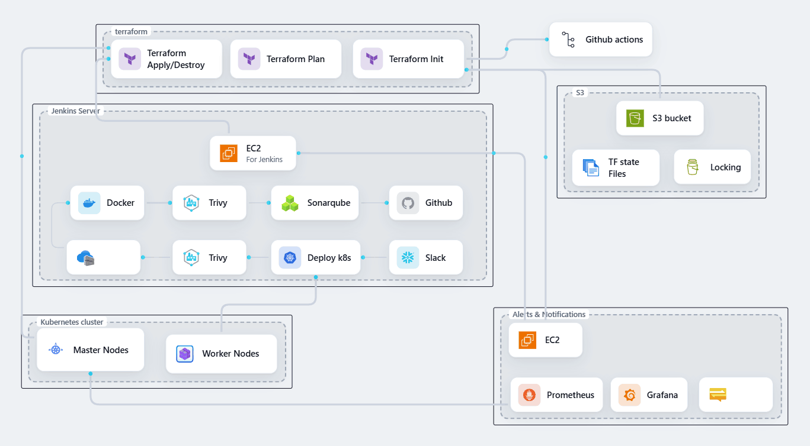
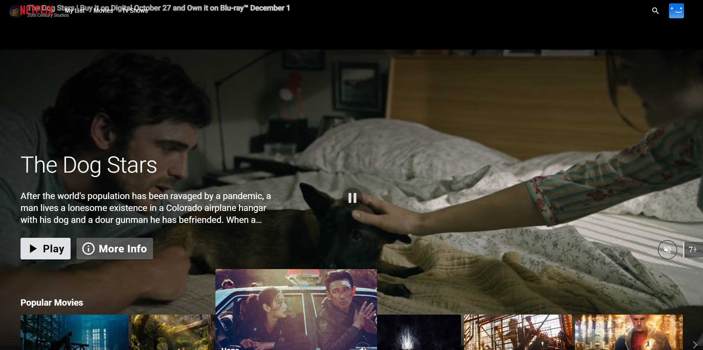
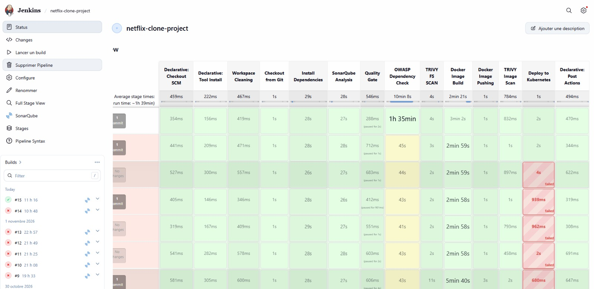
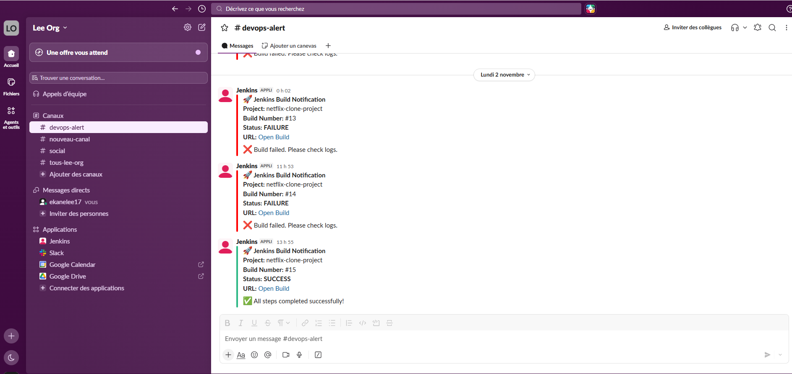
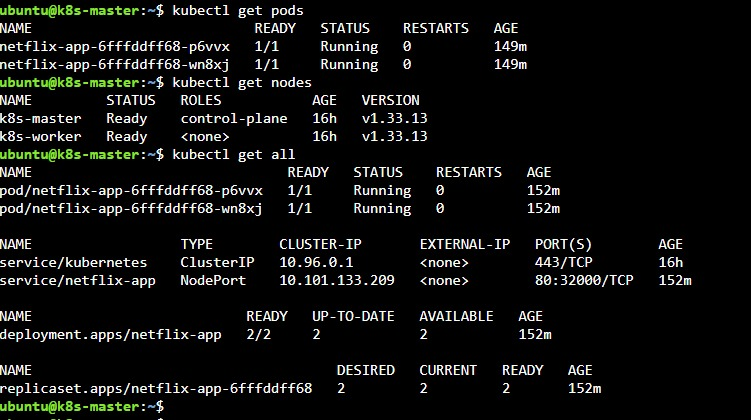
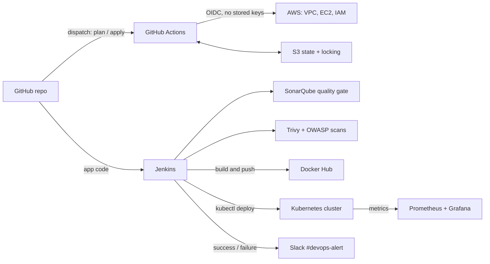
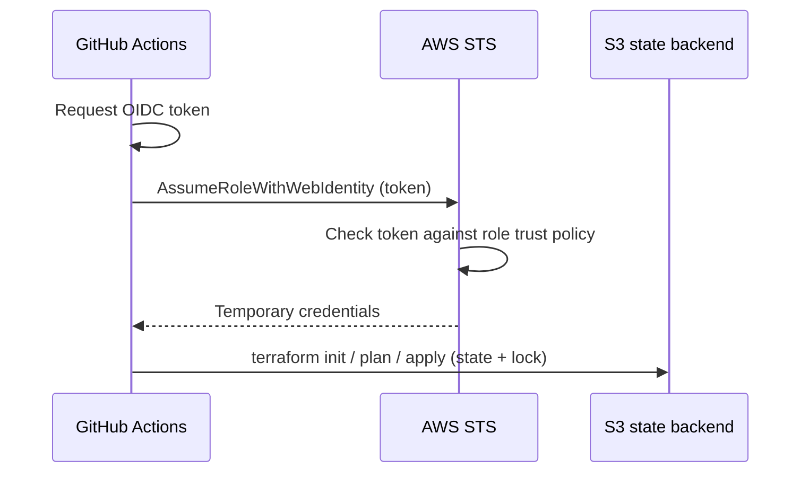

# Netflix on Kubernetes: End-to-End DevOps on AWS


A DevOps portfolio project that takes a Netflix-style web app from an empty AWS account to a monitored, automated Kubernetes deployment. **The app is not the point. Everything underneath it is:** infrastructure as code, a secure Terraform backend, keyless CI/CD authentication, a Jenkins pipeline with security scanning, a self-managed Kubernetes cluster, and monitoring with alerts.

I'm building this in public in five parts. Part 1 (the cloud foundation) is complete and documented below.



---

## Table of contents
 
- [Demo](#demo)
- [Project status](#project-status)
- [Architecture](#architecture)
- [Part 1: Cloud foundation](#part-1-cloud-foundation)
- [Part 2: Jenkins CI/CD pipeline](#part-2-jenkins-cicd-pipeline)
- [Part 3: Self-managed Kubernetes cluster](#part-3-self-managed-kubernetes-cluster)
- [Part 4: Monitoring](#part-4-monitoring)
- [Key design decisions](#key-design-decisions)
- [Repository structure](#repository-structure)
- [Getting started](#getting-started)
- [Lessons learned](#lessons-learned)
- [Hardening backlog](#hardening-backlog)
- [Cost warning](#cost-warning)
- [Credits and licensing](#credits-and-licensing)
- [About the author](#about-the-author)
---
 
## Demo
 
**The application running on the Kubernetes cluster:**
 

 
**The Jenkins pipeline.** The red rows are the real debugging history: each failure taught me something before the first fully green run.
 


**Slack canal notifications from builds**


 
**The cluster: 2 nodes, 2 replicas, exposed through a NodePort service.**
 

 
---
 
## Project status
 
| Part | Focus | Status |
|---|---|---|
| 1 | Foundation: Terraform, remote state bootstrap, OIDC, GitHub Actions | ✅ Complete |
| 2 | Jenkins CI/CD: SonarQube, OWASP, Trivy, Docker, Slack | ✅ Complete |
| 3 | Self-managed Kubernetes cluster and app deployment | ✅ Complete |
| 4 | Monitoring with Prometheus and Grafana | ✅ Complete |
| 5 | Alerts and lessons learned | 🟡 Slack build notifications live; metric-based alerting is the next iteration |
 
Each part was also written up as a LinkedIn build log: *[add your LinkedIn post link here]*.
 
---
 
## Architecture
 
| Zone | What it does |
|---|---|
| **Terraform** | Provisions the AWS infrastructure. `init`, `plan` and `apply`/`destroy` run on demand through GitHub Actions. |
| **S3** | Stores Terraform state remotely, with locking so two runs can never write at once. |
| **Jenkins server** (EC2) | Runs the CI/CD pipeline: checkout, SonarQube analysis, quality gate, OWASP dependency check, Trivy scans, Docker build and push, Kubernetes deploy, Slack notification. |
| **Kubernetes cluster** | Self-managed on EC2 with a master (control-plane) node and a worker node, running the application. |
| **Monitoring server** (EC2) | Prometheus and Grafana for metrics and dashboards. |
 
### End-to-end flow
 

 
### How GitHub Actions authenticates to AWS (OIDC)
 
No AWS access keys are stored anywhere. Each workflow run exchanges a short-lived GitHub-issued token for temporary AWS credentials.
 

 
---
 
## Part 1: Cloud foundation
 
**1. Bootstrap configuration** (`bootstrap/`), run once from a local machine:
- S3 bucket for Terraform state: versioned, encrypted (AES-256), public access fully blocked, protected with `prevent_destroy`
- DynamoDB table for state locking
- GitHub OIDC identity provider in AWS
- IAM role assumable only by this repository's workflows
**2. Main infrastructure** (`Terraform/`), applied through GitHub Actions:
- VPC with public subnets, internet gateway and route table
- Security group for the instances
- Four EC2 instances: Jenkins server, monitoring server, Kubernetes master node and Kubernetes worker node
- IAM role and instance profile (SSM access), so the instances can be administered through **AWS Systems Manager Session Manager** instead of SSH keys
- Ubuntu AMI lookup, with remote state in the bootstrap-created bucket
**3. GitHub Actions workflow** (`.github/workflows/terraform.yml`):
- Manually triggered with a **plan / apply / destroy** dropdown
- Runs `terraform fmt -check` and `terraform validate` before every action
- Authenticates through OIDC and runs inside a protected `production` environment
---
 
## Part 2: Jenkins CI/CD pipeline
 
Jenkins runs on its own EC2 instance and builds, scans, publishes and deploys the application.
 
### Server setup
- Installed Jenkins following the [official Linux guide](https://www.jenkins.io/doc/book/installing/linux/), reached through Session Manager and the instance's public IP
- Installed **Docker** (to build images and to run SonarQube) and added the `jenkins` and `ubuntu` users to the `docker` group
- Ran **SonarQube Community** as a container: `docker run -d --name sonarqube -p 9000:9000 sonarqube:community`
- Installed **Trivy** (image and filesystem scanning) and **kubectl** (so Jenkins can deploy to the cluster)
### Jenkins configuration
- Plugins: SonarQube Scanner, NodeJS, OWASP Dependency-Check, Docker, Docker Commons, Docker Pipeline, Pipeline Stage View, Rebuilder, Kubernetes
- Tools: NodeJS and SonarQube Scanner installations
- Credentials stored in Jenkins (never in the repo): SonarQube token (`sonar-token`), Docker Hub access token, TMDB API key
- SonarQube: project `NetflixClone`, plus a webhook back to Jenkins so the pipeline can wait for the **quality gate** result
- Pipeline job `netflix-clone-project`, using *Pipeline script from SCM* with the `Jenkinsfile` in the `jenkins/` folder
### Pipeline stages
 
| # | Stage | Purpose |
|---|---|---|
| 1 | Checkout SCM / Tool Install | Load the Jenkinsfile and configure NodeJS |
| 2 | Workspace Cleaning, Checkout from Git | Start from a clean copy of the source |
| 3 | Install Dependencies | `npm` install for the Node.js app |
| 4 | SonarQube Analysis | Static code analysis |
| 5 | Quality Gate | Fail the build if the quality gate fails |
| 6 | OWASP Dependency Check | Scan third-party dependencies for known vulnerabilities |
| 7 | Trivy FS Scan | Scan the filesystem for vulnerabilities and secrets |
| 8 | Docker Image Build | Build the application image |
| 9 | Docker Image Pushing | Push the image to Docker Hub |
| 10 | Trivy Image Scan | Scan the built image |
| 11 | Deploy to Kubernetes | Roll the new image out to the cluster |
| 12 | Post Actions | Send the result to Slack |
 
### Slack notifications
A Slack app (a "Jenkins" bot with `chat:write` and related scopes) posts build results to `#devops-alert`. The first failed build produced the first notification, which made it easy to confirm the integration worked.
 
<details>
    <summary>Slack app manifest used</summary>
    ```yaml
    display_information:
    name: Jenkins
    
    features:
    bot_user:
        display_name: Jenkins
        always_online: true
    
    oauth_config:
    scopes:
        bot:
        - channels:read
        - chat:write
        - chat:write.customize
        - files:write
        - reactions:write
        - users:read
        - users:read.email
        - groups:read
    
    settings:
    org_deploy_enabled: false
    socket_mode_enabled: false
    token_rotation_enabled: false
    ```
 
</details>
---
 
## Part 3: Self-managed Kubernetes cluster
 
I built the cluster myself on EC2 instead of using EKS or AKS, to understand what managed services hide.
 
- Connected to both nodes through Session Manager and set the control-plane hostname to `k8s-master`
- Installed `kubelet`, `kubectl` and the supporting tooling on both nodes, then joined the worker to the cluster
- Result: Kubernetes **v1.33** with one control-plane node and one worker, both `Ready`
- The app runs as a **Deployment** (`netflix-app`, 2 replicas) exposed through a **NodePort** service (`80:32000`)
- Jenkins deploys to the cluster with `kubectl` and the Kubernetes plugins; the app is reachable at `http://<node-public-ip>:32000`
---
 
## Part 4: Monitoring
 
- Installed **Prometheus** and **Grafana** on the dedicated monitoring server
- Configured Prometheus to collect metrics from the Kubernetes master node
- Grafana provides dashboards on top of those metrics
---
 
## Key design decisions
 
### Why a separate bootstrap?
Terraform needs a remote backend to be safe in CI, but something has to create that backend first. If one configuration both creates and uses the bucket, there is nowhere to store state on the very first run. A tiny bootstrap config (local state, run once) creates the backend, and everything else stores its state there from day one.
 
### Why OIDC instead of access keys?
Long-lived AWS keys in GitHub secrets are a liability, especially in a public repo. With OIDC, GitHub Actions receives temporary credentials per run. The role's trust policy is scoped to this repository and the `production` environment, so other repositories and forks cannot assume it.
 
### Why `workflow_dispatch` only?
The infrastructure workflow has no `push` or `pull_request` triggers. It runs only when someone with write access clicks **Run workflow**, so outsiders cannot trigger infrastructure changes through pull requests or forks.
 
### Why `create_before_destroy` on the security group?
Changing a value that feeds the security group name forces replacement, and by default Terraform destroys the old group first, which is impossible while instances are attached. With `create_before_destroy`, the new group is created, the instances are re-attached, and only then is the old one removed.
 
### Why scan at several points in the pipeline?
Each tool catches a different class of problem: SonarQube checks code quality, OWASP Dependency-Check flags vulnerable libraries, Trivy FS scans the source tree, and Trivy image scans the final artifact. Failing early is cheaper than failing in production.
 
### Why a self-managed cluster?
EKS or AKS would be faster. Building the control plane and joining a worker by hand teaches how the pieces fit together, which makes managed services easier to reason about later.
 
---
 
## Repository structure
 
```
Netflix_Clone_DevOps/
├── .github/workflows/
│   └── terraform.yml        # plan / apply / destroy workflow (OIDC)
├── bootstrap/               # one-time: state bucket, locking, OIDC role
│   ├── main.tf
│   ├── variables.tf
│   ├── outputs.tf
│   └── terraform.tfvars.example
├── Terraform/               # main infrastructure (remote state in S3)
│   ├── main.tf              # EC2 instances
│   ├── vpc.tf               # VPC, subnets, security group
│   ├── iam.tf               # roles and instance profile
│   ├── gather.tf            # data sources (AMI lookup)
│   └── ...
├── jenkins/
│   └── Jenkinsfile          # CI/CD pipeline definition
├── app/                     # application code (see Credits)
│   └── LICENSE
├── docs/                    # diagram and screenshots
├── LICENSE
└── README.md
```
 
---
 
## Getting started
 
### Prerequisites
- An AWS account and the [AWS CLI](https://docs.aws.amazon.com/cli/latest/userguide/getting-started-install.html) configured locally (needed only for the one-time bootstrap)
- [Terraform](https://developer.hashicorp.com/terraform/install) >= 1.12
- A GitHub account, a Docker Hub account, a Slack workspace, and a free [TMDB](https://www.themoviedb.org/) API key
### 1. Provision the foundation (Part 1)
 
```bash
git clone https://github.com/ekanelee/Netflix_Clone_DevOps.git
cd Netflix_Clone_DevOps/bootstrap
cp terraform.tfvars.example terraform.tfvars   # edit with your own values
terraform init && terraform apply
terraform output
```
 
Then update the `backend "s3"` block in `Terraform/` with your bucket name, and in GitHub add the secrets `AWS_ROLE_ARN` and `AWS_REGION` and an environment named `production`.
 
Run the workflow from the **Actions** tab: choose `plan` first, then `apply`.
 
### 2. Set up Jenkins (Part 2)
Connect to the Jenkins instance through Session Manager, then install Jenkins, Docker, Trivy and kubectl. Add the `jenkins` user to the `docker` group and restart Docker:
 
    ```bash
    sudo usermod -aG docker jenkins
    sudo usermod -aG docker ubuntu
    sudo systemctl restart docker
    docker run -d --name sonarqube -p 9000:9000 sonarqube:community
    ```
 
In Jenkins, install the plugins listed above, add the credentials, connect SonarQube and Slack, and create a pipeline job that reads `jenkins/Jenkinsfile` from this repository.
 
### 3. Build the cluster (Part 3)
Set hostnames on the two Kubernetes instances, install `kubelet`, `kubectl` and the supporting tooling on both, initialise the control plane, and join the worker. Verify with `kubectl get nodes`.
 
### 4. Add monitoring (Part 4)
Install Prometheus and Grafana on the monitoring server, point Prometheus at the cluster, and build dashboards in Grafana.
 
### 5. Run the pipeline
Trigger the Jenkins job. A successful run builds and scans the image, pushes it to Docker Hub, deploys it, and notifies Slack. Open `http://<worker-or-master-public-ip>:32000` to see the app.
 
---
 
## Lessons learned
 
### Infrastructure (Part 1)
 
| Problem | Cause | Fix |
|---|---|---|
| `Not authorized to perform sts:AssumeRoleWithWebIdentity` | The OIDC token's `sub` claim didn't match the trust policy. The job used an `environment`, which changes the claim, and GitHub's newer format embeds immutable user and repo IDs. | Printed the actual token claims in a debug step, then matched them with wildcards (`repo:user@*/repo@*:environment:production`). |
| `AccessDenied` on IAM actions | `PowerUserAccess` deliberately excludes IAM. | Attached IAM permissions alongside it. Both are needed. |
| Security group stuck destroying for 10+ minutes | Replacement ordering deadlock: instances still referenced the old group. | `lifecycle { create_before_destroy = true }`. |
| `EntityAlreadyExists` on IAM role and instance profile | An interrupted run created the resource in AWS but never recorded it in state. | `terraform import` to adopt the existing resource. |
| `Error acquiring the state lock` | A cancelled run left a stale lock behind. | `terraform force-unlock <ID>`. |
| `PendingVerification` on EC2 launch | Standard AWS verification hold on a new region or account. | Waited for AWS to clear it, then re-ran. |
 
### Pipeline (Parts 2 to 4)
 
Every failed build moved one stage further. The Pipeline Stage View plugin made it obvious where each run broke and how long each stage took, and the Slack alerts confirmed the failure within seconds.
 
| Failing stage | Cause | Fix |
|---|---|---|
| Install Dependencies / SonarQube | Node.js errors in the build environment | Fixed the Node setup, then confirmed the results in the SonarQube console |
| OWASP Dependency Check | The plugin wasn't installed yet | Installed the OWASP Dependency-Check plugin |
| Docker Image Build / Push | Docker credentials and plugins weren't configured | Created a Docker Hub repo and access token, installed the Docker plugins, added the credential in Jenkins |
| Docker Image Build | The TMDB API key wasn't supplied to the build | Generated a TMDB key and stored it as a Jenkins credential |
| Deploy to Kubernetes | The cluster didn't exist yet | Built the cluster in Part 3, then the stage went green |
 
**Observations**
- Stage timings varied a lot: the OWASP check took about 45 seconds on most runs and over an hour on one. That stage downloads vulnerability data, so caching it (and using an NVD API key) is worth setting up.
- A good stage view and chat alerts turn debugging from guesswork into a checklist.
- **Takeaway:** a failed or cancelled Terraform run can leave state and reality out of sync. Run `terraform plan -refresh-only` before retrying instead of applying blindly.
---
 
## Hardening backlog
 
This is a learning project, and some choices favor speed over least privilege. Known items to tighten:
 
- [ ] Replace the broad `PowerUserAccess` and IAM permissions on the Actions role with a scoped, least-privilege policy
- [ ] Restrict the security group from `0.0.0.0/0` to the specific ports and IP ranges each service needs
- [ ] Put Jenkins and SonarQube behind TLS and an IP allowlist (or a load balancer), and change default credentials
- [ ] Give the `jenkins` user Docker access through group membership only, never by loosening the Docker socket's file permissions
- [ ] Serve the app through an Ingress with TLS instead of a bare NodePort
- [ ] Move instances to private subnets with SSM-only access
- [ ] Migrate state locking from DynamoDB to native S3 locking (`use_lockfile`), since `dynamodb_table` is deprecated
- [ ] Add Prometheus alert rules and route them to Slack
- [ ] Explore a GitOps flow: a separate manifests repo with Argo CD handling delivery
- [ ] Add required reviewers on the `production` environment
---
 
## Cost warning
 
This project creates real AWS resources, including four EC2 instances, that **bill while they run**. Jenkins and SonarQube are also internet-facing unless you restrict them. When you're done experimenting, run the infrastructure workflow with the `destroy` action. The state bucket is protected with `prevent_destroy`, so it survives a destroy on purpose.
 
---
 
## Credits and licensing
 
- The application code in `app/` comes from [Netflix-Clone-K8S-End-to-End-Project](https://github.com/AmanPathak-DevOps/Netflix-Clone-K8S-End-to-End-Project) by **Aman Pathak**, used under the MIT License. His license is preserved in [`app/LICENSE`](app/LICENSE). The infrastructure, automation and documentation in this repository are my own work.
- Infrastructure code (`bootstrap/`, `Terraform/`, `.github/`, `jenkins/`) is released under the MIT License, see [`LICENSE`](LICENSE).
- This product uses the TMDB API but is not endorsed or certified by TMDB.
- This is an educational project and is not affiliated with, endorsed by, or connected to Netflix.
---
 
## About the author
 
**Brandon**, DevOps / Cloud Engineer (Azure AZ-104, AZ-204, AZ-400), working with Kubernetes, Terraform, GitHub Actions and observability tooling across Azure and AWS. This project is my AWS-native take on a full delivery pipeline.
 
- GitHub: [@ekanelee](https://github.com/ekanelee)
- LinkedIn: *[my linkedIn](https://www.linkedin.com/in/ekanebrandon17/)*

If this helped you, a ⭐ on the repo is appreciated. Questions and suggestions are welcome in the issues tab.