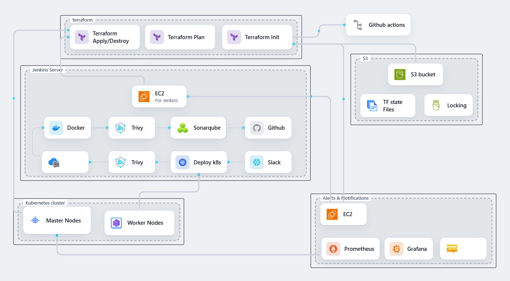
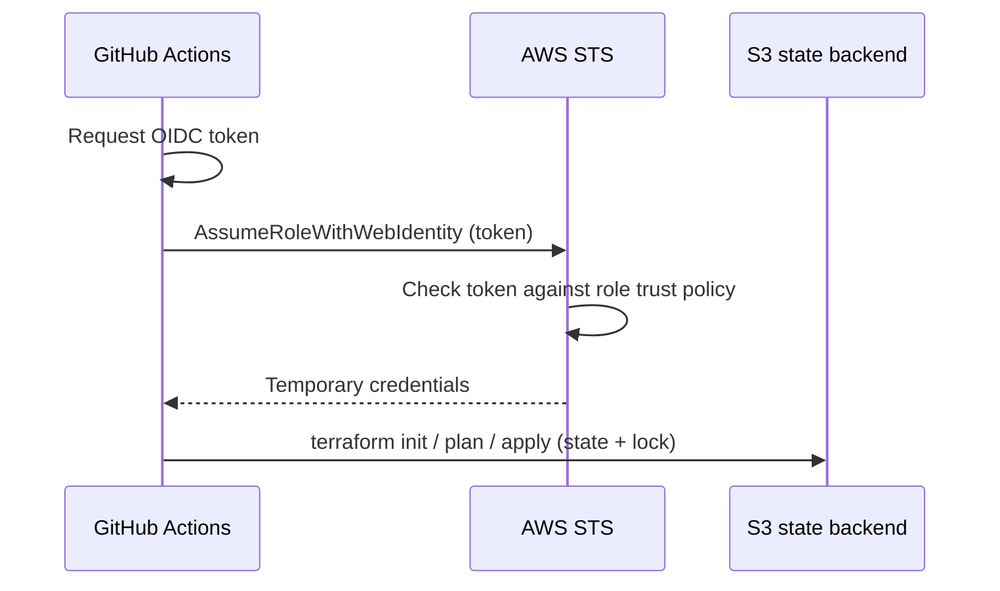

# Netflix on Kubernetes: End-to-End DevOps on AWS


A DevOps portfolio project that takes a Netflix-style web app from an empty AWS account to a monitored, automated Kubernetes deployment. **The app is not the point. Everything underneath it is:** infrastructure as code, a secure Terraform backend, keyless CI/CD authentication, a Jenkins pipeline with security scanning, a self-managed Kubernetes cluster, and monitoring with alerts.

I'm building this in public in five parts. Part 1 (the cloud foundation) is complete and documented below.



---

## Table of contents

- [Project status](#project-status)
- [Architecture](#architecture)
- [Part 1: What's built](#part-1-whats-built)
- [Key design decisions](#key-design-decisions)
- [Repository structure](#repository-structure)
- [Getting started](#getting-started)
- [Running the pipeline](#running-the-pipeline)
- [Lessons learned](#lessons-learned)
- [Hardening backlog](#hardening-backlog)
- [Cost warning](#cost-warning)
- [Credits and licensing](#credits-and-licensing)
- [About the author](#about-the-author)

---

## Project status

| Part | Focus | Status |
|---|---|---|
| 1 | Foundation: Terraform, remote state bootstrap, OIDC, GitHub Actions | ✅ Complete |
| 2 | Jenkins CI pipeline: SonarQube, Trivy, Docker build | 🔜 Planned |
| 3 | Kubernetes cluster and application deployment | 🔜 Planned |
| 4 | Monitoring with Prometheus and Grafana | 🔜 Planned |
| 5 | Alerts, Slack notifications, lessons learned | 🔜 Planned |

Each part is also written up as a LinkedIn build log: *[add your LinkedIn post link here]*.

---

## Architecture

The animated diagram above shows the target end state. In plain terms:

| Zone | What it does |
|---|---|
| **Terraform** | Provisions the AWS infrastructure. `init`, `plan` and `apply`/`destroy` run on demand through GitHub Actions. |
| **S3** | Stores Terraform state remotely, with locking so two runs can never write at once. |
| **Jenkins server** (EC2) | Runs the CI/CD pipeline: GitHub checkout, SonarQube code analysis, Trivy scans, Docker build, deploy to Kubernetes, Slack notification. |
| **Kubernetes cluster** | A self-managed cluster on EC2 with a master node and a worker node, running the application. |
| **Alerts and notifications** (EC2) | Prometheus and Grafana for metrics and dashboards, with alerting. |

### How GitHub Actions authenticates to AWS (OIDC)

No AWS access keys are stored anywhere. Each workflow run exchanges a short-lived GitHub-issued token for temporary AWS credentials.



---

## Part 1: What's built

**1. Bootstrap configuration** (`bootstrap/`), run once from a local machine:
- S3 bucket for Terraform state: versioned, encrypted (AES-256), public access fully blocked, protected with `prevent_destroy`
- DynamoDB table for state locking
- GitHub OIDC identity provider in AWS
- IAM role assumable only by this repository's workflows, with permissions to manage the infrastructure

**2. Main infrastructure** (`Terraform/`), applied through GitHub Actions:
- VPC with public subnets, internet gateway and route table
- Security group for the instances
- Four EC2 instances: Jenkins server, monitoring server, Kubernetes master node and Kubernetes worker node
- IAM role and instance profile for the instances (SSM access)
- AMI lookup for Ubuntu
- Remote state in the S3 bucket created by the bootstrap

**3. GitHub Actions workflow** (`.github/workflows/terraform.yml`):
- Manually triggered with a **plan / apply / destroy** dropdown
- Runs `terraform fmt -check` and `terraform validate` before every action
- Authenticates to AWS through OIDC and runs inside a protected `production` environment

---

## Key design decisions

### Why a separate bootstrap?
Terraform needs a remote backend to be safe in CI, but something has to create that backend first. If one configuration both creates and uses the bucket, there is nowhere to store state on the very first run. Splitting it in two solves this: a tiny bootstrap config (local state, run once) creates the backend, and everything else stores its state there from day one.

### Why OIDC instead of access keys?
Long-lived AWS keys in GitHub secrets are a liability, especially in a public repo. With OIDC, GitHub Actions receives temporary credentials per run. The role's trust policy is scoped to this specific repository and to the `production` environment, so other repositories and forks cannot assume it.

### Why `workflow_dispatch` only?
The workflow has no `push` or `pull_request` triggers. It runs only when someone with write access manually clicks **Run workflow**, so outsiders cannot trigger infrastructure changes through pull requests or forks. The `production` environment can additionally require an approval before any `apply` or `destroy`.

### Why `create_before_destroy` on the security group?
The security group name includes a naming variable. Changing it forces a replacement, and by default Terraform destroys the old group first, which is impossible while instances are still attached to it. With `create_before_destroy`, Terraform creates the new group, re-attaches the instances, and only then removes the old one.

---

## Repository structure

```
Netflix_Clone_DevOps/
├── .github/workflows/
│   └── terraform.yml        # plan / apply / destroy workflow (OIDC)
├── bootstrap/               # one-time: state bucket, locking, OIDC role
│   ├── main.tf
│   ├── variables.tf
│   ├── outputs.tf
│   └── terraform.tfvars.example
├── Terraform/               # main infrastructure (remote state in S3)
│   ├── main.tf              # EC2 instances
│   ├── vpc.tf               # VPC, subnets, security group
│   ├── iam.tf               # roles and instance profile
│   ├── gather.tf            # data sources (AMI lookup)
│   └── ...
├── Application-Code/                     # application code (see Credits)
│   └── LICENSE
├── docs/
│   └── architecture.gif
├── LICENSE
└── README.md
```

---

## Getting started

### Prerequisites
- An AWS account and the [AWS CLI](https://docs.aws.amazon.com/cli/latest/userguide/getting-started-install.html) configured locally (needed only for the one-time bootstrap)
- [Terraform](https://developer.hashicorp.com/terraform/install) >= 1.12
- A GitHub account (to fork or clone this repo)

### 1. Clone the repository
```bash
git clone https://github.com/ekanelee/Netflix_Clone_DevOps.git
cd Netflix_Clone_DevOps
```

### 2. Run the bootstrap (once)
```bash
cd bootstrap
cp terraform.tfvars.example terraform.tfvars   # then edit with your own values
terraform init
terraform apply
terraform output
```
Set a **globally unique** bucket name in `terraform.tfvars`, plus your GitHub username and repository name. Note the `github_actions_role_arn` output for the next step.

### 3. Point the main config at your backend
Update the `backend "s3"` block in `Terraform/` with the bucket name from your bootstrap output.

### 4. Configure GitHub
In your repository: **Settings → Secrets and variables → Actions**, add:

| Secret | Value |
|---|---|
| `AWS_ROLE_ARN` | The `github_actions_role_arn` output from the bootstrap |
| `AWS_REGION` | Your AWS region, e.g. `us-east-1` |

Then create an environment named `production` under **Settings → Environments**. Adding yourself as a required reviewer is recommended.

---

## Running the pipeline

1. Go to the **Actions** tab and select the Terraform workflow.
2. Click **Run workflow** and choose an action:
   - `plan` previews the changes. Always run this first.
   - `apply` provisions the infrastructure.
   - `destroy` tears it all down.
3. Review the run logs.

---

## Lessons learned

Real problems hit while building Part 1, and what fixed them:

| Problem | Cause | Fix |
|---|---|---|
| `Not authorized to perform sts:AssumeRoleWithWebIdentity` | The OIDC token's `sub` claim didn't match the trust policy. The job used an `environment`, which changes the claim, and GitHub's newer format embeds immutable user and repo IDs. | Printed the actual token claims in a debug step, then matched the trust policy with wildcards (`repo:user@*/repo@*:environment:production`). |
| `AccessDenied` on IAM actions | `PowerUserAccess` deliberately excludes IAM. | Attached IAM permissions alongside it. Both are needed. |
| Security group stuck destroying for 10+ minutes | Replacement ordering deadlock: instances still referenced the old group. | `lifecycle { create_before_destroy = true }`. |
| `EntityAlreadyExists` on IAM role and instance profile | An interrupted run created the resource in AWS but never recorded it in state. | `terraform import` to adopt the existing resource. |
| `Error acquiring the state lock` | A cancelled run left a stale lock behind. | `terraform force-unlock <ID>`. |
| `PendingVerification` on EC2 launch | Standard AWS verification hold on a new region or account. | Waited for AWS to clear it, then re-ran. |

**Takeaway:** a failed or cancelled Terraform run can leave state and reality out of sync. Run `terraform plan -refresh-only` before retrying instead of applying blindly.

---

## Hardening backlog

This is a learning project, and some choices favor speed over least privilege. Known items to tighten:

- [ ] Replace the broad `PowerUserAccess` and IAM permissions on the Actions role with a scoped, least-privilege policy
- [ ] Restrict the security group ingress rules from `0.0.0.0/0` to specific ports and IP ranges
- [ ] Migrate state locking from DynamoDB to native S3 locking (`use_lockfile`), since the `dynamodb_table` option is deprecated
- [ ] Place the instances in private subnets behind a bastion or SSM-only access
- [ ] Add required reviewers on the `production` environment

---

## Cost warning

This project creates real AWS resources, including four EC2 instances, that **bill while they run**. When you're done experimenting, run the workflow with the `destroy` action. The state bucket is protected with `prevent_destroy`, so it survives a destroy on purpose.

---

## Credits and licensing

- The application code in `app/` comes from [Netflix-Clone-K8S-End-to-End-Project](https://github.com/AmanPathak-DevOps/Netflix-Clone-K8S-End-to-End-Project) by **Aman Pathak**, used under the MIT License. His license is preserved in [`Application-Code/LICENSE`](Application-Code/LICENSE). The infrastructure, automation and documentation in this repository are my own work.
- Infrastructure code (`bootstrap/`, `Terraform/`, `.github/`) is released under the MIT License, see [`LICENSE`](LICENSE).
- This product uses the TMDB API but is not endorsed or certified by TMDB.
- This is an educational project and is not affiliated with, endorsed by, or connected to Netflix.

---

## About the author

**Brandon-Lee**, DevOps / Cloud Engineer (Azure AZ-104, AZ-204, AZ-400), working with Kubernetes, Terraform, GitHub Actions and observability tooling across Azure and AWS. This project is my AWS-native take on a full delivery pipeline.

- GitHub: [@ekanelee](https://github.com/ekanelee)
- LinkedIn: *[my linkedIn](https://www.linkedin.com/in/ekanebrandon17/)*

If this helped you, a ⭐ on the repo is appreciated. Questions and suggestions are welcome in the issues tab.